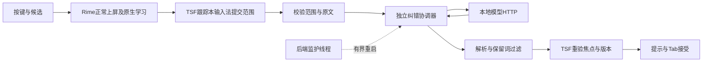

# 开发进度复核：稳定性、恢复与真实模型（2026-10-20）

## 当前判断

固定响应的真实记事本验收已完成，不能再把主要任务写成“尚无提示”。本轮重点补协调器异常退出后的恢复，并把真实小模型接到自有TSF测试宿主的完整自动链路。新代码只在工作区构建，尚未部署系统安装版。

| 项目 | 状态 |
| --- | --- |
| 基本中文、候选、Shift、鼠标中断与退格 | 前轮用户在真实记事本确认通过 |
| 固定响应上文回读、提示、Tab保留ni | 前轮真实记事本及元数据共同验收 |
| 真实本地模型→协调器→TSF提示→Tab | 本轮两架构自有TSF宿主通过；焦点和候选锚点仍有测试配置，不等同真实记事本验收 |
| 协调器崩溃恢复 | 新增后台有界监护；实际协调器子进程恢复接口已验证，后端构建通过，未安装 |
| 模型质量 | 仍有漏报和错误建议；18条合成语料不能支持总体准确率结论 |
| 高频词与习惯 | 继续复用Rime原生学习，不新增重复记录机制；用户设置/清理与更广泛体验仍待核对 |

## 本轮生产代码改动范围

只新增 `include/CorrectionBrokerSupervisor.h`，并将 `WeaselServerApp::Run` 中原本的一次性协调器子进程启动改为监护启动。

- 启动、等待子进程退出和重试都在专用后台线程执行；不在输入线程、TSF编辑锁或Rime请求回调中等待推理/重启。
- 初次启动后最多3次重试，依次250/1000/3000ms；连续失败后保持Exhausted，不无限拉起。
- 子进程稳定运行60秒后恢复连续失败额度。测试用缩短的策略核验此逻辑，生产默认不变。
- Stop能够打断退避，关闭父管道请求正常退出；原有单子进程Job作为卡死退出的清理后备。
- 状态快照只保存阶段、PID、尝试数、连续失败数、最后退出码及启动失败标记；没有正文、请求队列、重放或跨线程COM对象。
- Running只表示子进程存在，不是端点就绪。实际端点恢复另由认证的设置请求验证；前轮监听健康失败会使协调子进程退出，监护据此恢复。
- 监护仅管理纠错协调器，不自动启动或重启用户的模型服务。状态快照尚未接到管理界面，耗尽后也尚无单独GUI重试按钮；当前可通过重启专用后端重新开始。

本轮没有改动TSF范围/隐私门控、候选与Tab应用算法、Rime按键上屏和原生学习代码。

## 新增和保留的验证

| 定向检查 | x64 | Win32 |
| --- | --- | --- |
| 监护启动/崩溃/退避/耗尽/稳定恢复/立即退出/析构/无响应清理 | 16/16 | 16/16 |
| 实际协调器认证端点→结束自有子进程→自动恢复→EOF正常退出 | 5/5 | 5/5 |
| 监听接受前断连与容量边界 | 12/12 | 12/12 |
| 完整协调器协议/鉴权/关闭/取消/慢响应 | 26/26 | 26/26 |
| 当前源码探测DLL的自动纠错与中断回归 | 293/293 | 293/293 |
| 真实本地模型通过协调器驱动提示/Tab | 18/18 | 18/18 |

自动回归从287增至293，新增两类在途取消：导航键、生命周期结束。它们通过真实管道与生产解析链路，分别检查推理确已开始、旧请求取消不改正文、后续新请求仍可得到建议。此前依赖已构建探测DLL的早期检查不作为最终证据；本轮重建两架构探测DLL后重跑以上293项。

监护的合成子进程测试只结束本测试创建、核对映像路径的子进程，不结束用户应用。实际协调器恢复测试同样使用工作区受控子进程；本轮未启动独立输入后端或系统TIP。

独立正式Server两架构构建通过；保留已有 `localtime` 弃用警告及测试文件局部变量遮蔽警告，没有顺带改动无关代码。

## 真实小模型测试与质量边界

使用已下载并校验的 Qwen3-4B-Q4_K_M.gguf 和现有 llama.cpp 运行时，临时监听 `127.0.0.1:18963`。无下载、无服务注册，不读取日常输入、日常词库或其他应用正文。

新增测试命令 `--automatic-broker-http` 仅供集成测试程序使用：只处理编译的合成句子，使用PID专用临时设置根，真实协调器不注入传输替身，实际调用本地HTTP/模型，再经过生产解析、TSF重新校验、提示与Tab。完成后删除临时设置根，停用自有宿主并核对DLL可卸载。

两次提交后等待建议的测量为953ms（x64）和750ms（Win32）。此计时从合成提交返回后开始，测试使用100ms去抖，包含IPC/HTTP/模型/解析及轮询，不能当作默认250ms去抖下的P95或纯推理耗时。真实手动输入速度、焦点和候选位置仍须实机验收。

另一组独立的质量测试使用同一模型：

| 语料 | 结果 |
| --- | --- |
| 开发组：3错句+7对照句 | 87检查通过，10次模型调用 |
| 另一组：3错句+5对照句 | 71检查中2项质量失败，8次模型调用；接口/归属/时效及卸载检查通过 |
| 本次两组请求耗时 | 最小234ms，中位250ms，最大547ms；仅本机小样本 |

默认0.90阈值下，共6个错句中的4个显示预期修正，12个对照句未显示错误建议。剩余两项与此前记录一致：

- `记绿→记录` 为正确建议，但模型报0.85，未显示。
- `收倒→收下` 为错误建议，模型同样报0.85，未显示；期望是“收到”。

因此没有降低默认阈值、替换预期答案或把失败吞掉。下一阶段应扩大独立语料并分析提示/模型输出，不能凭自评分将误报风险视为已解决。测试程序对内置合成响应会输出诊断副本；这不用于用户正文日志。

## 数据路径与后续边界

模型故障时，纠错可以失败或取消，正常输入应继续；旧请求不因协调器恢复而重放。当前没有读取任意历史文档或新增全文长期缓存。

## 收尾与恢复

- 临时模型进程和启动脚本已退出，`local-model/ready.json` 已移除；启动脚本在受控结束模型后返回非零，是本轮收尾方式，不是本次启动或推理失败。
- 最终核对没有本轮模型、测试程序或专用后端/协调器进程。
- 独立安装200文件哈希与原版输入法基线一致；独立纠错mode=Off、automatic=false，固定响应标记关闭。
- 系统独立安装仍为前轮已验收版本；新监护在工作区Server.exe中，未覆盖安装目录，未改注册或日常词库。测试词库/安装和模型权重继续保留。
- `output/LocalTest/development-review-state-2026-10-20.json` 为本轮恢复入口；上轮实际安装信息继续保留在 `broker-acceptance-active-2026-10-19.json`。

下一步先准备仅更新后端EXE的受限回退包，再进行真实记事本模型与异常恢复验收。现有 `Update-CorrectionBroker.ps1` 只允许两份Deployer.exe，不能直接用来更新Server.exe；应先扩展或新增专用方案并验证。

主要日志：`output/recovery-final-*-{x64,Win32}-20261020.log`、`recovery-automatic-*-20261020.log`、`broker-real-model-*-20261020.log`、`model-development-20261020.log`、`model-holdout-20261020.log`。后续待办集中在 [任务清单](CORRECTION_TASKS.md)，历史过程在 [归档](CORRECTION_PROGRESS_ARCHIVE_2026-10-19.md)。
