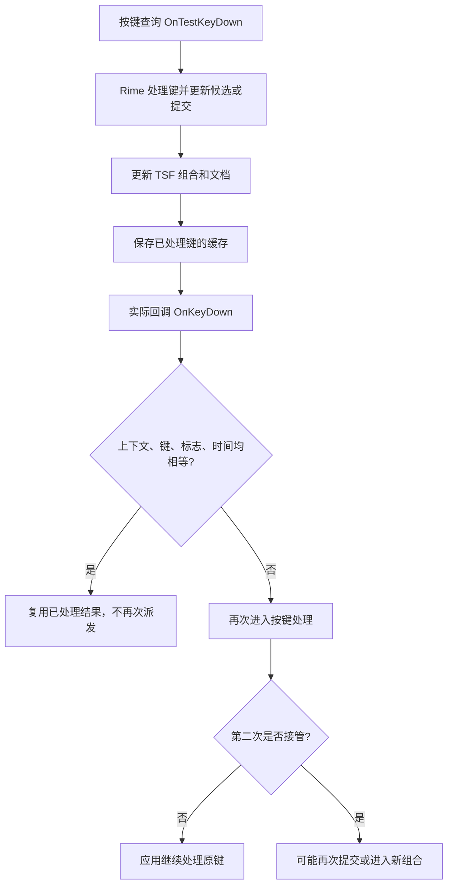

# Word 重复输入：派发证据与机制分析（2026-10-26）

## 当前状态

按用户要求，已将诊断安装 c136296 回退到上一安装 aaa844d。回退后的 manifest 与诊断更新前的备份逐字节一致，200 文件全部匹配，原输入法基线一致，自有后端 / 模型 / 测试进程退出。纠错 Off，不继续 Word、Edge 或模型测试。此次仅分析和记录，没有新增生产按键补丁。

回退包 `output/LocalTest/UpdatePatch-Rollback-20261026-155320`，结果 `word-rollback-verified-20261026.json`。回退的是本机测试安装；源码历史和诊断证据保留，便于后续复现。

用户实测：多余 1、双句号仍在；新观察到上屏后句号需确认且变成英文点号。搜狗正常。诊断只增加明确选择测试进程的记录，没有修改派发判断，但增加了 IPC 和微小时序开销；不能据此断言新现象与诊断毫无关系，也不能直接认定诊断引入了新的处理规则。

## 1. 已确认的前端派发缺陷

新鲜现场日志：`output/LocalTest/pipeline-20261026-074945-d0da1be9cb3b46339c29429ebcd4146b.jsonl`。元数据差分摘要：`word-dispatch-evidence-summary-20261026.json`。

| 连续观察 | 按下回调累计 | 派发入口累计 | 缓存复用累计 | 未接管累计 | 实际回调未匹配累计 | 原因位 | 编辑代数变化累计 |
| --- | ---: | ---: | ---: | ---: | ---: | ---: | ---: |
| 07:50:08.598 UTC | 10 | 5 | 5 | 0 | 0 | 0 | 1 |
| 07:50:08.929 UTC | 12 | 7 | 5 | 1 | 1 | 16 | 1 |

后一个区间有 2 次新回调、2 次新派发、没有复用、1 次未接管。原因从 0 变为 16，表示存在缓存，且上下文身份、键、完整 lParam 相同，**只有 GetMessageTime 不同**。编辑代数未变化。之后又观察到相同类型的差分。

这确认 `_HandleKey` 的时间相等条件在现场阻断了缓存复用，让实际回调再次进入 `_ProcessKeyEvent`。不能再将它解释为范围读取失败或消息标志变化。

边界：`dispatches` 统计进入 `_ProcessKeyEvent`，不是成功 IPC 次数。该函数还可能因键盘状态或连接状态提前返回，因此尚不能仅凭计数宣称每次都已再次进入 Rime。日志不记录原始键码、原文或窗口身份，也没有 Word 内部 WM_CHAR 跟踪；“具体哪个字符由哪个内部函数插入”仍需与受控后端对照。全程后续还包含其他回调，不能按累计总数倒推出完整键串。

集成候选通道未观察到记录；详细元数据是尽力发送，不能把缺少记录当作绝对未调用。此次证据优先指向普通 TSF 查询 / 实际回调路径。

## 2. Word 与输入法如何衔接

需要区分三个层次：按键接管、TSF 文本写入、应用自身的字符处理。

微软[按键管理器查询契约](https://learn.microsoft.com/en-us/windows/win32/api/msctf/nf-msctf-itfkeystrokemgr-testkeydown)说明，应用先查询是否接管，再调用实际 KeyDown；[实际处理契约](https://learn.microsoft.com/en-us/windows/win32/api/msctf/nf-msctf-itfkeystrokemgr-keydown)说明，实际返回未接管时应用应继续处理该键。返回 S_OK 本身不表示键被接管，BOOL 输出同样关键。

本项目当前路径：

实际回调与查询回调之间，宿主可能处理其他消息。[GetMessageTime](https://learn.microsoft.com/en-us/windows/win32/api/winuser/nf-winuser-getmessagetime)反映线程最近取出的消息时间，不是 TSF 传入的不可变按键 ID；接口没有保证两次回调取到相同值。上轮提前取时间只解决“查询内部处理期间时间改变”的情况，解决不了“查询与实际回调之间已经换了最近消息”的情况。

上屏则由 `_ApplyCompositionResponse` 在写编辑会话中操作组合范围、SetText 和选区，再结束组合。一般 TSF 文本存储由应用向 TSF 暴露（如 [ITextStoreACP](https://learn.microsoft.com/en-us/windows/win32/api/textstor/nn-textstor-itextstoreacp)，另有锚点接口）；这与宿主是否继续处理原始键是两条衔接的路径。没有取得 Word 私有实现，不能宣称本次文档一定使用 ACP 而不是锚点存储。

若输入法先在查询中写入“你好”，随后实际回调却放行数字 1，应用继续处理该数字就可能形成“你好1”。[TranslateMessage](https://learn.microsoft.com/en-us/windows/win32/api/winuser/nf-winuser-translatemessage)是 Windows 将虚拟键转成字符消息的常见机制，但本轮没有证明 Word 最终插入经过了该具体函数。

因此，“Word 读取字符”在这里主要是按键所有权和文档编辑通知的协调问题；这轮纠错关闭，没有运行模型，上文捕获失败不是解释重复字符所必需的条件。

## 3. 英文点号 / 待确认的相关 Rime 机制

本地源码提供了一条可进一步验证的连锁解释：

1. `librime/src/rime/engine.cc` 的 `ConcreteEngine::ProcessKey` 把未处理键加入短期 `commit_history`，然后返回 false。
2. `commit_history.cc` 对无修饰的可打印 ASCII 建立记录；`commit_history.h` 将这类记录标为 `thru`。
3. `gear/punctuator.cc` 的 `is_after_number` 会检查历史最后一项是否以数字结束，类型为 thru / raw。
4. `ConvertDigitSeparator` 在数字后将点号作为 `punct_number`，默认不立即提交；`PunctTranslator::Query` 会保留输入符号作为候选。`punctuator.h` 默认分隔符含点号，默认 action 不立即 commit。
5. 当前公开方案的普通点号映射是中文“。”，但数字分隔符走另一分支。这可解释为什么相同按键在错误数字进入历史后变成待确认的“.”。

推断链是：选词键重复处理 → 第二次数字被当成直通键 → 数字短期历史 → 小数点分支。它与用户的新现象吻合，但尚未直接取得该时刻 Rime 的会话状态，不能标作已经独立验证的完整根因。

本地 librime 源码修订为 1c23358；安装 DLL 未提供可读版本资源，本轮没有额外加载它核对源码对应关系。后续独立后端对照必须使用实际测试 DLL 和方案，不能只用源码结论替代实际版本验证。

这里的 `commit_history` 是引擎短期历史，不是用户词频学习库。不要为消除这一现象清空学习词库、禁用正常小数输入，或强行把所有英文点号替换成中文句号。

## 4. 为什么之前的回归没有揭示现场问题

前轮消息时钟测试主动把实际回调的时钟恢复为查询入口的原值，验证了“查询内部泵消息后仍保留原入口时间”。它没有模拟 Word 本次表现：实际回调本身取到不同时间。不同时间的测试还被作为“稍后的新物理按键应重新处理”的对照，因此隐含了时间可识别按键的假设。

计数测试中的 DifferentMessageTime 场景证明了诊断能看见重复派发，却没有规定这是不是同一次按键；它不是 Word 输入正确性的验收。今后不能以该断言通过推断该场景功能正常。

根本盲点是把时钟相等与回调属于同一个键混为一谈。Word 的现场差分已经否定这条一般性假设。过去“入口提前取时间”的修复有覆盖范围，但不能称作现场完整修复。

## 5. 后续修复方向与验证门槛

本轮不直接删掉时间条件，也不部署替代规则。仅按键码去重会吞后续真实按键；固定延迟窗口也不能代替可靠的回调状态。

优先设计“查询已被处理的一次性凭据”：区分查询去重与实际回调确认；保留上下文身份、完整标志、编辑 / 焦点生命周期以及中途键事件边界；实际回调最多消费一次已处理查询结果。时间可作观测或过期辅助，不能作为唯一消息身份。若查询被遗弃、没有 key-up 且后续直接收到相同实际按键，仍存在消歧难题，必须明确处理和测试，不能隐去。

同时评估将查询时的后端响应与宿主写入分开，减少查询期间修改 Word 文档的副作用。但不能简单把所有写入挪到实际回调：引擎返回未处理时，应用可能不再调用实际回调，而该响应仍可能带有待提交文本。必须先用实际 Rime 验证这种返回值 / 提交组合，以及异步写锁和失焦取消。

先在独立合成宿主 / 私有后端覆盖：

- 查询与实际回调时间不同但属于同一轮：选词只提交一次，已处理结果不变成未接管。
- 同键下一次真实按下、自动重复、query 重入、缺失 actual、实际回调独立到达；抬起、焦点变化、切换文档后不复用旧凭据。
- 后端处理一次并提交 / 不提交、返回未处理但带提交、写锁失败、组合结束通知和延迟响应；不重复插入、不清除已输入文字。
- 真实方案分别对照正常 nihao+1+句号、刻意重复送入选词数字、正常小数 3.14、Shift 和 Ctrl 快捷键；验证小数点状态的来源。
- 记事本已通过的中文、退格、鼠标中断和纠错 Tab 路径保持通过；Edge 页面的替换持久化另行处理。

自有宿主和真实 Rime 对照通过后，才开展短 Word Off 实测，先证明附加数字和标点恢复，再测纠错 / Tab。模型配置保持冻结。
